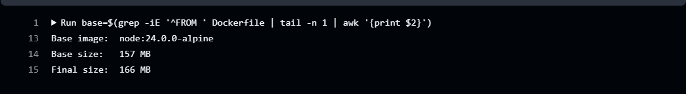
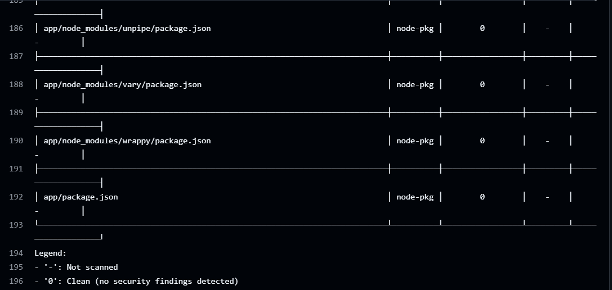

# Docker-File-Optimization

## Dockerfile Production checklist

| Checklist item | Status | How the [Dockerfile](Dockerfile) meets it |
|---|---|---|
| Intentional, pinned base image versions | ✅ | `node:24.0.0-alpine`: exact Node version, not `:latest`. |
| Minimal base images (slim, distroless, alpine) | ✅ | Alpine in both stages. |
| Multi-stage builds, no build tools in prod | ✅ | `build` → `runtime`. npm, npx, corepack and yarn are deleted from the runtime stage. |
| Non-root user set before CMD | ✅ | `USER node:node` (built-in user, UID 1000) before `CMD`. App files stay owned by root. |
| No secrets in image layers or ENV | ✅ | `ENV` holds only runtime settings. Named `COPY` paths, no `COPY . .`. `.dockerignore` excludes `.env`, `.npmrc`, keys. |
| HEALTHCHECK instruction defined | ✅ | `node src/healthcheck.js` calls `/healthz`. No curl or wget needed. |
| Vulnerability scanning in CI pipeline | ✅ | Trivy gate in [CI](.github/workflows/docker-build-scan.yml). Runs on every push to `main`. |
| `.dockerignore` committed to repo | ✅ | [.dockerignore](.dockerignore) exists and has been committed |
| Containers treated as disposable | ✅ | No SSH, read-only app code, stateless, exec-form `CMD` with `STOPSIGNAL SIGTERM` for a clean shutdown. |

## 1. Estimated image size reduction vs `FROM node:latest`

`node:latest` is built on full Debian with compilers, Python, git and curl, which makes it about 1.2 GB. Switching to an Alpine base brings the final image down to 166 MB, which is about 86% smaller. Removing devDependencies with `npm prune --omit=dev` and using a `.dockerignore` to keep `.git`, tests and the local `node_modules` out of the build keep the app layers small, so the final image is only 9 MB bigger than the base image.

The pipeline prints the base and final image sizes on every run:

## 2. How the multi-stage build reduces the attack surface

A multi-stage build uses one stage to install and build the app and a clean second stage to run it. Only the files copied into the second stage are shipped, so the build tools never reach production. This reduces the attack surface because:
- Fewer packages in the image means fewer CVEs for a scanner to find.
- Without npm, curl or a compiler, an attacker in the container can't easily download or build more tools.
- The npm cache, lockfile and devDependencies stay in the build stage and are thrown away.

## 3. How running as non-root prevents privilege escalation

Containers share the host's kernel and run as root by default. If an attacker breaks out of a container running as root, they are root on the host. Setting up a user limits what an attacker can do on the container.

## 4. How to scan this image in CI

Use a Trivy scanner on every pull_request/push that checks every package in the image against public CVE databases. Running it in CI makes it a gate, to prevent the image from being deployed to your environment. a vulnerable image is never pushed. It can also be setup to scan images, daily, weekly, or regularly to catch newly published CVEs.

The Trivy scan in the pipeline found no vulnerabilities in the app's packages (`0` = clean):

## 5. Handling a CVE in the base image with no fix available

No patch means upgrading won't fix the issue, you can use these methods;
- Check if the package is actually used by the app? Check the EPSS score and the CISA KEV list. If it is on KEV, treat it as urgent.
- If the app doesn't need the package, delete it. This Dockerfile does exactly that with npm. Otherwise switch to a base that doesn't include it (a newer Node release or distroless).
- Use a read-only filesystem, this can help to  drop the capabilities and network rules which makes the CVE harder to exploit.
- Use a `.trivyignore` file with a expirydate, after that date the pipeline fails again, so a new decision can be made. When a fix is released, rebuild, rescan, redeploy, and delete the `.trivyignore` file.
